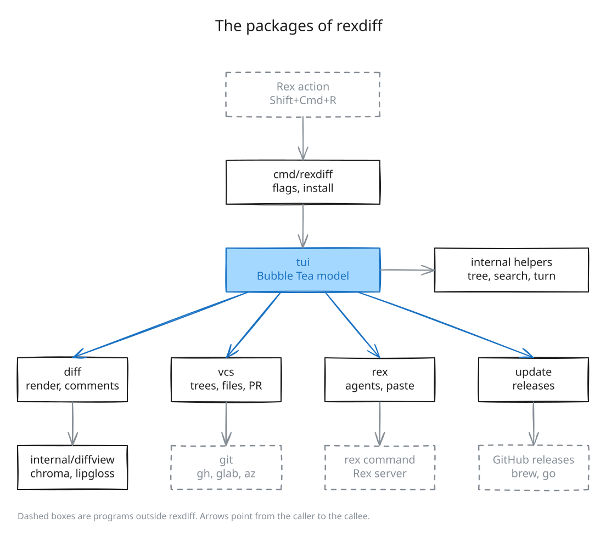

# Architecture

rexdiff is a Go program built on Bubble Tea. It runs in a Rex pane beside a coding
agent, shows the changes in the git repository, and pastes review comments into the
agent. It talks to Rex and git by running the `rex` and `git` commands and reading their
output.



The diagram is made from `.asset/arch.json` with Excalidraw. To edit it by hand, open
`.asset/arch.excalidraw` on excalidraw.com.

## Packages

`tui` holds the screen and all the state. It uses the libraries below, which do not
import each other.

- `diff` renders two versions of a file as coloured terminal lines and stores the
  review comments.
- `vcs` runs git, and gh, glab, or az for the pull request.
- `rex` runs the rex command.
- `update` installs a newer release and restarts rexdiff.

`internal/` holds helpers: the file tree, search ranking, turn detection, the clipboard,
the editor command, text cleaning, the runs of other programs, and the diff renderer
copied from crush. The libraries get their environment from `cmd/rexdiff`, and do not
read the environment of the process.
`internal/testgit` sets up git for the tests.

`cmd/rexdiff` parses the flags, handles `rexdiff install`, upgrades `rexdiff.lua` at
the start, and calls `tui`.

Only `cmd/rexdiff` reads the environment of the process, once, with `os.Environ`. It
gives that list to the libraries, which find and run their programs with it, as
`exec.Cmd.Env` does.

## Rex

Rex sets `REX_SESSION` and `REX_BLOCK` in every pane. When they are missing, rexdiff
runs without Rex. You can copy a review then, but you cannot send it.

Each request to Rex runs one rex command. This one lists the panes in the session:

```sh
rex api call -s $REX_SESSION session.list_blocks {}
```

A send asks Rex to paste the review into the agent's pane. rexdiff does not press Enter,
so you can read the text before the agent gets it.

Agents such as pi and Claude Code report their name and state to Rex with the OSC 7501
escape code. rexdiff reads that status from each pane and treats a pane that reports a
name as an agent. A `rex events` command stays running to stream state changes. If it
exits, rexdiff starts it again after 2 seconds.

`rexdiff install` writes `rexdiff.lua` into the Rex config folder. The file adds the
"Toggle rexdiff" action, which opens rexdiff in a pane beside the focused agent.

## Git

Each scope compares two git trees:

| Scope | Old side | New side |
| --- | --- | --- |
| uncommitted | the last commit | your files now |
| branch | the point where the branch left the base branch | your files now |
| last turn | your files when the agent's last turn started | your files now |
| commits | the parent of the first picked commit | the last picked commit |

To get a tree of your files now, rexdiff writes the working tree with a temporary index.
The real index stays untouched.

Every second, rexdiff checks the size and modification time of each file. It runs git
only after one of them changes.

## Runtime

Bubble Tea handles keys and timers on one goroutine, so the model has no locks.

A reload, each call to Rex or to a forge, and each code search run on another goroutine
with a time limit, and report back with a message. One reload runs at a time. A snapshot
keeps a private index, so git reads only the files that change.

A turn starts when an agent in the repository starts working, and ends when every agent
is idle. At the start of a turn, rexdiff saves a snapshot of the working tree. The
last-turn scope compares against it. If a file changes between the time that Rex reports
the start and the snapshot, the snapshot can hold that change. Then rexdiff drops the
turn, as herdr-reviewr does.

## State

Comments live in memory and are lost on quit. An update is the exception. rexdiff writes
them to a temporary file and starts the new binary in the same process, and the new
binary reads the file.

Two git refs under `refs/worktree/rexdiff/` keep the picked base branch and the
last-turn snapshot across restarts. Settings live at the top of `rexdiff.lua`.
