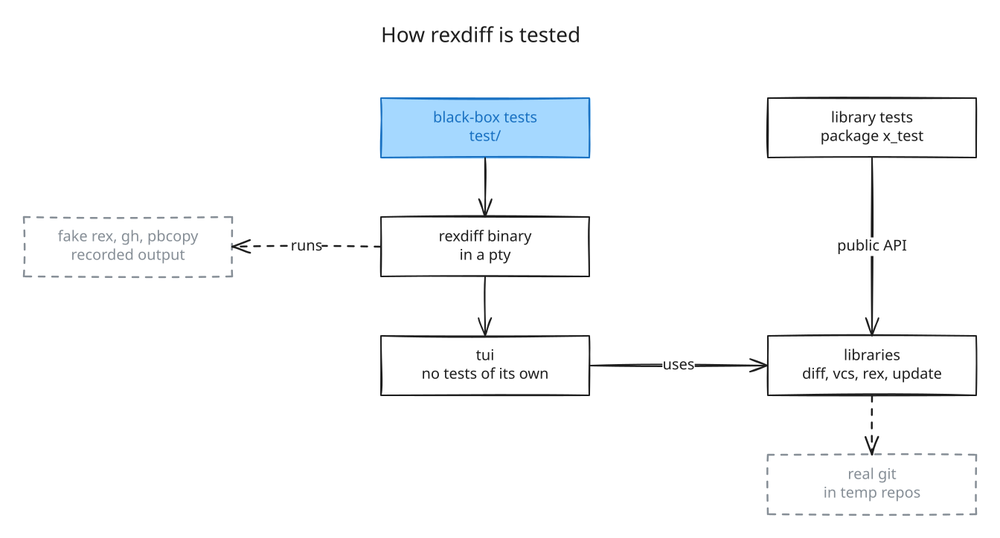

# Tests

rexdiff has two kinds of tests. The library tests check `diff`, `vcs`, `rex`,
`update`, and the `internal` packages through their public API only. The black-box
tests in `test/` build the rexdiff binary and use it the way you do: they type keys
and click in a terminal, and read the screen.

`tui` has no tests of its own. It only puts the libraries together, and the black-box
tests cover what it does.



## Library tests

Each test file is in `package x_test`, so a test can use only what the package
exports. A test that needs git runs real git in a temporary repository.
`internal/testgit` makes these repositories and hides your git config, so hooks or
signing do not change the result.

The libraries take their environment as a value, so each test gives its own
environment, with its own `PATH` for the fake tools. No library test changes the
environment of the process, so all of them run in parallel.

## Black-box tests

Each test starts rexdiff in a pseudo-terminal, sends keys or mouse events, and waits
for text on the screen:

```go
tm := start(t, newRepo(t), opts{})
tm.keys("]", "c", "h", "i", "enter")
tm.waitFor("💬 hi")
```

The keys and the mouse go through a terminal emulator, so rexdiff gets them as from a
real terminal. No test waits a fixed time for rexdiff. Each one waits for the screen or
for a file.

Short shell scripts on `PATH` stand in for rex, gh, pbcopy, and the editors. The fake
rex prints output recorded from a real Rex, in `test/testdata/rex`. The scripts in
`test/testdata/script` run the command line: errors, `install`, and `uninstall`.

`TestRealRex` runs rexdiff in a real Rex session, to catch a fake that no longer
matches Rex. It runs only when you ask for it.

The black-box tests run one at a time, because each one is a real program in a
terminal.
