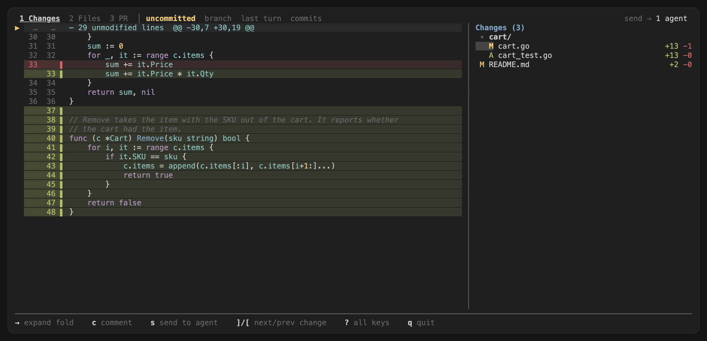
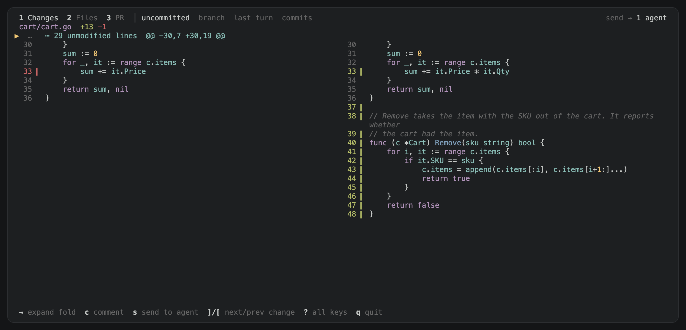
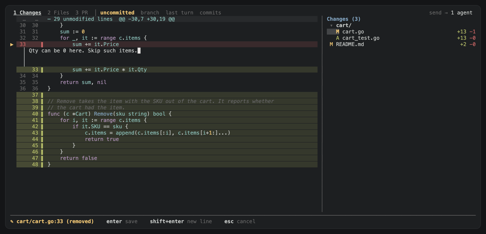
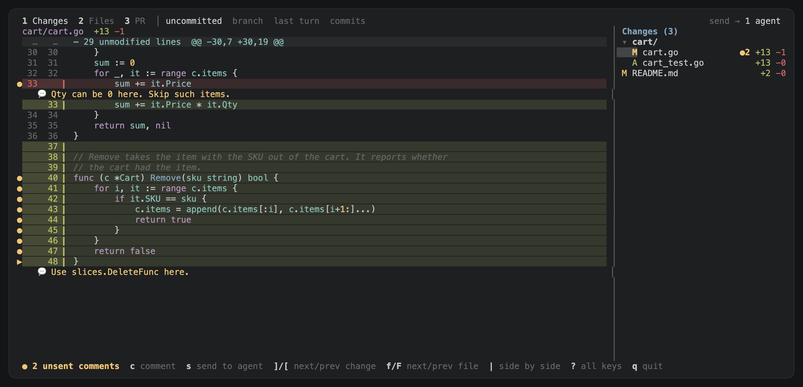
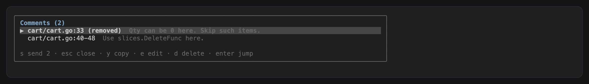
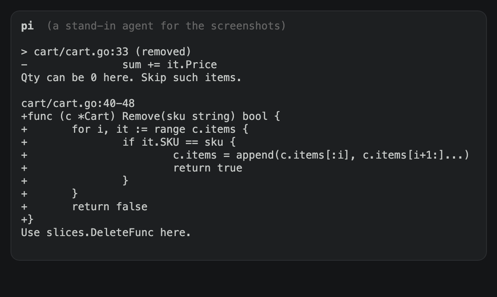
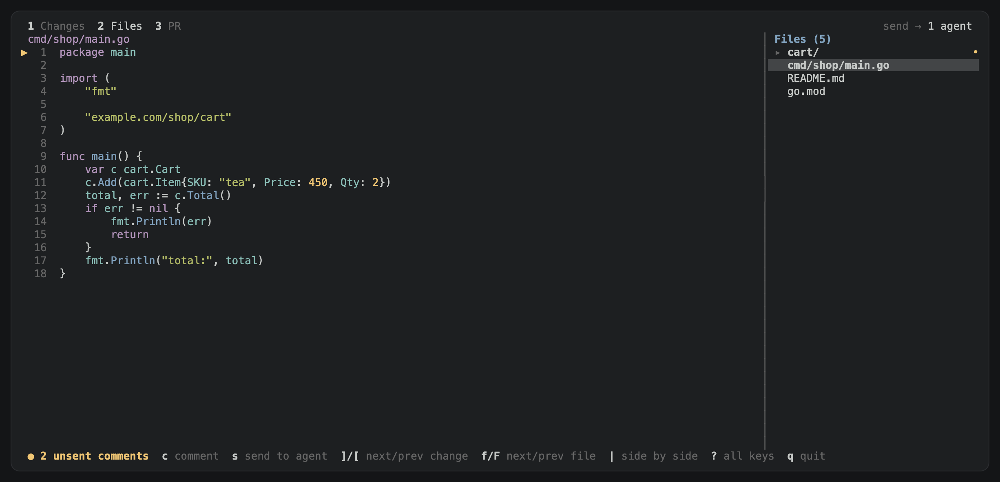
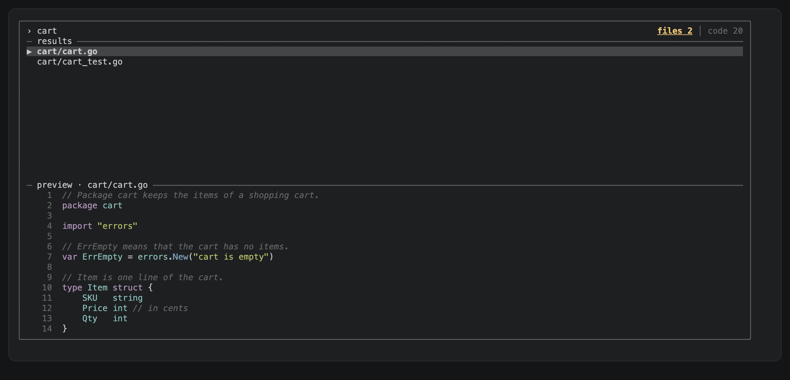
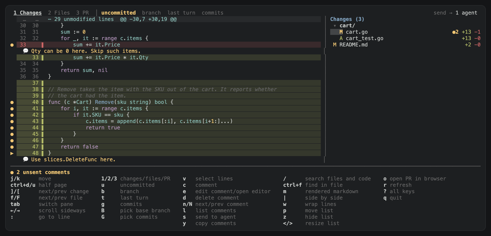

# User guide

rexdiff shows the changes of a coding agent in a Rex pane beside the agent. You comment
on lines and send the comments to the agent.

## 1. Install

```sh
brew tap rednafi/rexdiff https://github.com/rednafi/rexdiff
brew trust rednafi/rexdiff
brew install --cask rexdiff
rexdiff install
```

With Go, use `go install github.com/rednafi/rexdiff/cmd/rexdiff@latest`, then run
`rexdiff install`.

## 2. Open rexdiff

Focus the pane of the agent and press Shift+Cmd+R. Press it again to close rexdiff.



## 3. Read the diff

The diff is on the left. The changed files are on the right.

- `j` and `k` move one line.
- `]` and `[` go to the next or previous change.
- `f` and `F` go to the next or previous file.
- The right arrow key on a folded row shows the unchanged lines.

rexdiff reloads when a file changes.

## 4. Pick what to compare

- `u`: the uncommitted changes
- `b`: all the changes on the branch
- `t`: the last turn of the agent
- `g`: the commits that you pick

## 5. See both sides

Press `|` to see the old and the new code side by side. Press `z` to hide the file list
if the pane is narrow.



## 6. Comment

Put the cursor on a line, press `c`, type the comment, and press Enter. For more lines,
press `v` and move down first.



The comment shows under its code.



## 7. Change the comments

- `e` edits the comment under the cursor.
- `d` deletes it.
- `l` lists all the comments.



## 8. Send the review

Press `s`. rexdiff pastes the review into the input box of the agent. You press Enter.



Press `y` to copy the review instead.

## 9. See all the files

Press `2` to see all the files of the repository. You can comment there too.



## 10. Search

Press `/` to find a file. Press Tab to find code.



## 11. See the pull request

Press `3` to see the pull request of the branch, with its checks and comments. This needs
gh, glab, or az.

## 12. Change the settings

The settings are in `~/.config/rex/rexdiff.lua`:

```lua
local settings = {
  key = "shift+cmd+r",   -- the toggle key, or false for none
  placement = "split",   -- split, zoomed, tab, or overlay
  direction = "right",   -- of the split: right or down
  layout = "unified",    -- or split
  editor = "code -g {file}:{line}",
  keybindings = { send = { "S" } },
}
```

The other settings are as in
[herdr-reviewr](https://github.com/persiyanov/herdr-reviewr), with these changes:

- `layout`, `placement`, and `direction` are its `diff_view`, `toggle_placement`,
  and `toggle_direction`.
- `file_list` is its `navigator_position`.
- rexdiff adds `file_list_width`, `diff_signs`, and `focus_agent_after_send`.
- rexdiff has no `theme` and no `auto_open`.

After a change, run `rex config reload`.

Press `?` to see all the keys.



Press `U` to update when the bottom line shows a new version. Press `q` to quit.
`rexdiff uninstall` removes rexdiff from Rex.
