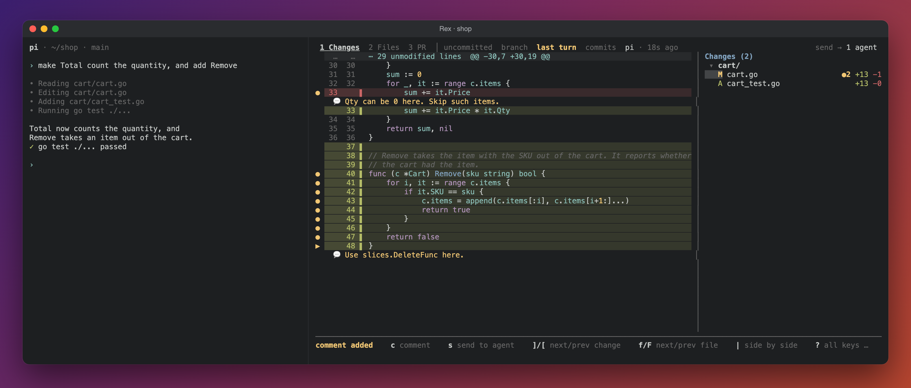

<div align="center">
  
  <h1>rexdiff</h1>
  <p>
    <b>Review what your coding agent changed, without leaving <a href="https://www.superlogical.com/rex">Rex</a>.</b><br>
    Think <a href="https://github.com/persiyanov/herdr-reviewr">herdr-reviewr</a>, but for Rex.
  </p>
  <p>
    <a href="https://github.com/rednafi/rexdiff/releases/latest"></a>
    <a href="https://github.com/rednafi/rexdiff/actions/workflows/ci.yml"></a>
    
    <a href="LICENSE"></a>
  </p>
  <p>
    <b>
      <a href=".doc/user.md">User guide</a>
      &nbsp;·&nbsp;
      <a href=".doc/arch.md">Architecture</a>
      &nbsp;·&nbsp;
      <a href=".doc/dev.md">Development</a>
      &nbsp;·&nbsp;
      <a href=".doc/test.md">Tests</a>
    </b>
  </p>
</div>

<p align="center">
  <a href="https://github.com/user-attachments/assets/d56af0f9-e1ff-422d-b0e7-0e5afe3320ae">
    
  </a>
  <br>
  <sub><a href="https://github.com/user-attachments/assets/d56af0f9-e1ff-422d-b0e7-0e5afe3320ae">Watch the demo</a></sub>
</p>

## Why

- The diff opens in a Rex pane beside the agent, so you don't switch apps.
- The last-turn scope shows only what the agent changed in its most recent turn.
- Press `s` and rexdiff pastes your comments into the agent's input, each with its file
  and line.

## Install

```sh
brew tap rednafi/rexdiff https://github.com/rednafi/rexdiff
brew trust rednafi/rexdiff
brew install --cask rexdiff
rexdiff install
```

Then press <kbd>Shift</kbd>+<kbd>Cmd</kbd>+<kbd>R</kbd> next to an agent.
